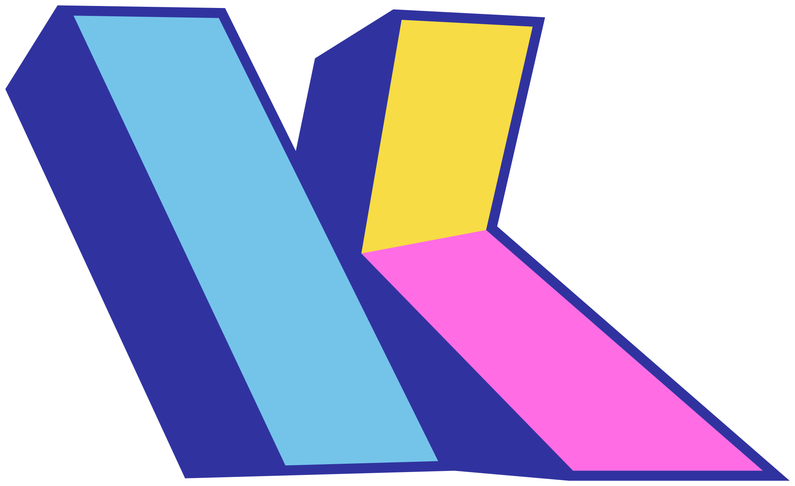

<p align="center"></p>

# KitoGL

An OpenGL video compositor for Qt in Python (PySide6 and PySide2). It draws a decoded video picture, an RGBA overlay
and scene transitions on a native child surface of a Qt window, and it asks very little of the graphics card:
**OpenGL 2.1 or OpenGL ES 2**, so ANGLE on Windows 7 and 8 runs it too.

It was written for SimpleWorship, a program that projects song lyrics over video backgrounds, where the CPU used to
spend most of a 4K background's time converting and shrinking pictures.

## What it does

- **YUV to RGB in one shader**: 8-bit 4:2:0 planes (or NV12 from a CUDA frame) are uploaded as they come from the
  decoder, padded rows included, and converted with the BT.601, BT.709 or BT.2020 matrix, limited or full range.
- **Cover**: the picture fills the target, centred and cropped, never stretched.
- **Box-filtered shrinking**: up to 4 x 4 bilinear taps per output pixel, written out with no loop, close to OpenCV's
  `INTER_AREA`; plain bilinear when it enlarges.
- **Overlay**: a premultiplied RGBA image (text, for example) drawn only inside its ink rectangle.
- **Scene transitions**: fade, wipe with a soft edge and push, between a live video and a still or another video.
- **Presentation pacing**: one swap per physical refresh with the video's cadence kept by a refresh counter, and a
  timer when the driver ignores vsync.
- **Fails safe**: anything that goes wrong (no context, a shader that does not compile, a software renderer) emits
  `failed`, so the application can draw by other means.

It does not decode. Hand it pictures from PyAV or anything else that gives plane addresses (see `kitogl.picture`).

## Requirements

- Python 3.8 or newer, and PySide6 or PySide2. KitoGL uses whichever the application already imported
  (`KITOGL_QT=pyside6|pyside2` chooses when none is).
- Pure Python: one wheel for Windows and Linux, 32 and 64 bit.

## Install

From a release. Each release's notes give the wheel's SHA-256; add it as `#sha256=...` to the URL and pip checks it:

```text
pip install "kitogl @ https://github.com/disruptedtag/kitogl/releases/download/v0.1.0/kitogl-0.1.0-py3-none-any.whl"
```

## Use

```python
from kitogl import GLVideoLayer

layer = GLVideoLayer(window)          # a child of `window`, covering it
layer.setGeometry(window.rect())
layer.set_picture_source(player.current_picture)   # a callable that returns the picture to show, or None
layer.set_text(overlay_image, ink_rect)            # optional RGBA overlay
layer.failed.connect(use_the_cpu_path)
layer.show()
```

`GLVideoLayer(parent, allow_software_renderer=False, cuda_uploader_factory=None)`:

- `allow_software_renderer` lets it draw on Mesa's llvmpipe or Windows' "GDI Generic" (useful for tests; slow).
- `cuda_uploader_factory` makes the object that copies a CUDA-resident picture (`cuda_resident = True`) into the
  layer's textures (`upload(picture, textures)`, `close()`), for applications that decode on an NVIDIA card.

`kitogl.color`, `kitogl.geometry` and `kitogl.shaders` need no Qt. `kitogl.trace.set_tracer(...)` receives a few
milestones (context ready, first picture drawn) for an application's own timeline.

## Tests

```text
python -m unittest discover -s tests
```

The drawing tests need an OpenGL surface: they skip on Qt 6's `offscreen` platform. GitHub Actions runs them on Linux
under Xvfb with Mesa; a real card (Windows) is tested by hand.

## License

MIT. See `LICENSE`.
